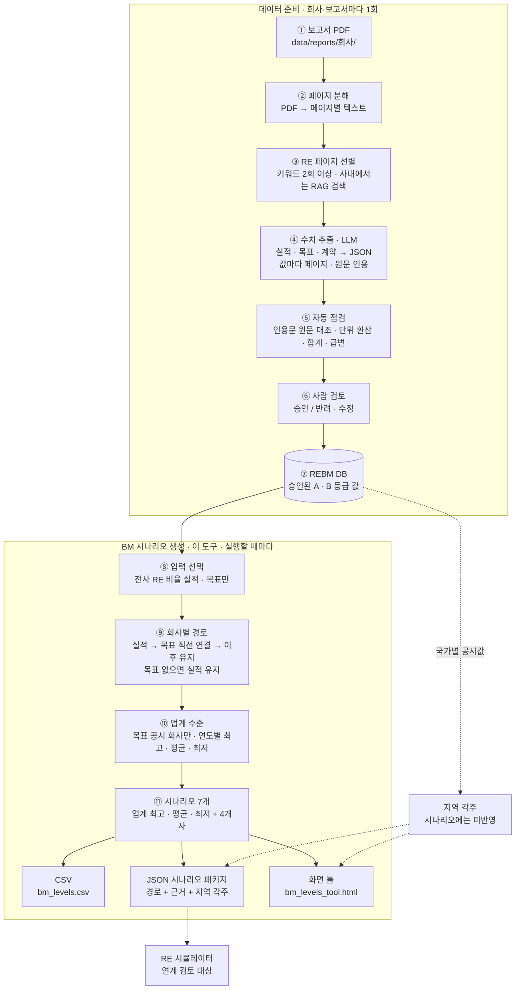

# 경쟁사 RE 수준 비교 도구 설명서

2026-11-25 기준 · REBM의 시나리오 생성 부분만 다룹니다 (데이터 추출·검토 과정은 `REBM_guide.md` 참조)

## 1. 무엇을 하는 도구인가

경쟁사가 지속가능경영보고서에 공시한 RE 전력 비율 실적과 목표만으로, "누구 수준을 따라가면" 연도별로 RE 비율이 얼마가 되는지를 시나리오로 만들어 나란히 비교합니다. 우리 회사 전력수요나 배출계수는 쓰지 않으며, 결과는 RE 시뮬레이터 같은 다른 도구에 목표 경로로 넘길 수 있습니다.

LLM은 쓰지 않습니다. 정해진 규칙으로 계산하는 코드라서 같은 입력이면 항상 같은 결과가 나옵니다.

| 구분 | 내용 |
| --- | --- |
| 받는 것 | 경쟁사 전사 RE 비율 실적·목표 (REBM DB의 승인된 값), 연도 범위, 포함할 회사 |
| 처리 | 회사별 경로 생성 → 연도별 업계 최고·평균·최저 계산 |
| 내보내는 것 | 시나리오 7개의 연도별 RE 비율 (CSV, JSON 시나리오 패키지, 화면) |
| 실행 | `python -m re_bm.cli bm-levels` 또는 화면 툴 `tool/bm_levels_tool.html` |

### 1-1. 워크플로우 (지속가능경영보고서 분해부터)



①~⑦은 보고서를 데이터로 바꾸는 준비 단계로, 새 보고서가 나올 때만 합니다. ⑧~⑪이 이 도구가 하는 일이며, 계산은 LLM 없이 코드로 합니다. LLM은 ④에서만 쓰입니다.

| 단계 | 받는 것 | 처리 | 내보내는 것 | 현재 상태 |
| --- | --- | --- | --- | --- |
| ① 보고서 수집 | 경쟁사 지속가능경영보고서 | 회사 폴더에 저장, 출처 기록 | PDF, `SOURCES.md` | 4개사 완료 (TSMC는 Climate and Nature Report) |
| ② 페이지 분해 | PDF | 페이지마다 텍스트 추출 (pdfplumber) | 페이지별 텍스트 | 완료 |
| ③ RE 페이지 선별 | 페이지별 텍스트 | 재생에너지·PPA·REC·RE100·MWh 등 키워드가 2회 이상 나온 페이지만 선택 | 관련 페이지 (예: SK hynix 132쪽 → 11쪽) | 완료. 사내에서는 RAG 검색으로 대체 가능 |
| ④ 수치 추출 | 관련 페이지 텍스트 | LLM이 정해진 형식으로 옮겨 적기 (값은 원문 그대로, 계산·추정 금지) | JSON (`data/extractions/*.json`) | 완료 (대화형 LLM으로 작성). API·사내 LLM 연동 가능 |
| ⑤ 자동 점검 | JSON, 원본 PDF | 인용문이 해당 페이지에 있는지 대조, 단위 환산, 합계·비율·급변 점검 | 검토 대기 상태 데이터 + 경고 | 완료 (인용문 전 항목 확인) |
| ⑥ 사람 검토 | 검토 CSV | 승인/반려, 필요 시 값 수정 | 승인 상태 | 일괄 승인 가정 (실제 검토 전) |
| ⑦ REBM DB | 승인 데이터 | 근거·등급과 함께 저장 | `data/re_benchmark.db` | 실적 66건, 목표 7건, 계약 6건 |
| ⑧ 입력 선택 | DB | 승인된 A·B 등급의 전사 RE 비율 실적·목표만 읽기 | 4개사 실적·목표 | 이 도구 |
| ⑨ 회사별 경로 | 실적·목표, 연도 범위 | 실적 → 목표 직선 연결, 마지막 목표 이후 유지, 목표 없으면 실적 유지 | 회사별 연도 경로 | 이 도구 |
| ⑩ 업계 수준 | 회사별 경로 | 전사 RE 목표 공시 회사(TSMC·SK hynix·Intel)만으로 연도별 최고·산술평균·최저 | 업계 최고·평균·최저 경로 (+ 최고·최저를 낸 회사) | 이 도구 |
| ⑪ 출력 | 시나리오 7개 | 파일·화면으로 내보내기, 국가별 공시값은 각주로 첨부 | CSV, JSON 패키지, 화면 툴 | 이 도구 |

## 2. 시나리오 7개

모두 **전사(GLOBAL) RE 전력 비율(%)** 기준입니다.

| 시나리오 | 의미 |
| --- | --- |
| 업계 최고 수준 | 그 해 업계 수준 대상 회사 중 가장 높은 값 |
| 업계 평균 수준 | 그 해 업계 수준 대상 회사 값의 단순 산술평균 |
| 업계 최저 수준 | 그 해 업계 수준 대상 회사 중 가장 낮은 값 |
| TSMC 수준 | TSMC 경로 |
| SK hynix 수준 | SK hynix 경로 |
| Intel 수준 | Intel 경로 |
| Micron 수준 | Micron 경로 (업계 수준 계산에서는 제외, 3-2 참조) |

## 3. 계산 규칙

### 3-1. 회사별 경로

1. 승인된 공시값만 씁니다 (A: 공시값 그대로, B: 공시값끼리 계산한 값). 추정값(C)은 쓰지 않습니다.
2. 실적이 있는 연도는 실적값을 씁니다.
3. 마지막 실적 이후는 공시 목표연도까지 직선으로 잇습니다. 목표가 여러 개면 차례로 잇습니다.
4. 마지막 목표 이후는 그 값을 유지합니다.
5. 목표가 없는 회사는 최근 실적을 유지합니다.

예: TSMC는 2025년 실적 20.1%, 2030년 목표 60%, 2040년 목표 100% → 2027년 36.1%, 2035년 80%, 2040년 이후 100%.

### 3-2. 업계 수준 (최고·평균·최저)

- **대상 회사:** 연도가 붙은 전사 RE 비율 목표를 공시한 회사만 (현재 TSMC, SK hynix, Intel).
  - 목표가 없는 회사는 경로가 최근 실적에 고정되어, 넣으면 업계 최저·평균이 '개선 없음' 가정에 끌려갑니다.
  - 목표를 공시하면 자동으로 다시 포함됩니다.
  - 필요하면 포함 가능: CLI `--include-no-target`, 화면 툴 "전사 RE 목표 미공시 회사도 포함" 스위치.
- **최고·최저:** 연도마다 대상 회사 값 중 최고·최저. 그 값을 낸 회사도 함께 기록합니다 (`industry_max_by`, `industry_min_by`).
- **평균:** 대상 회사 값의 단순 산술평균. 회사 규모(전력사용량)로 가중하지 않습니다(2026-11-25 확정).

| 연도 | TSMC | SK hynix | Intel | 업계 평균 |
| --- | --- | --- | --- | --- |
| 2025 | 20.1 (실적) | 31.0 (실적) | 99.0 (실적) | (20.1 + 31.0 + 99.0) / 3 = 50.0 |
| 2027 | 36.1 (보간) | 31.5 (보간) | 99.4 (보간) | 55.7 |
| 2030 | 60 (목표) | 33 (목표) | 100 (목표) | (60 + 33 + 100) / 3 = 64.3 |

### 3-3. Micron을 업계 수준에서 뺀 이유

Micron 2026 보고서(p.34~35)의 RE 관련 공시는 다음과 같으며, 연도가 붙은 전사 RE 비율 목표는 없습니다.

| 구분 | 내용 |
| --- | --- |
| 목표 | 미국 사업장 RE 100%, 2025년 말 (달성) |
| 유지 목표 | 말레이시아·중국 RE 100% 유지 (연도 없음) |
| 장기 지향점 | 가능한 곳에서 전 세계 무탄소전력(CFE) 100% (연도 없음, 원전·수력 포함 개념) |
| 관련 목표 | Scope 1+2 넷제로 2050년 (지향점, 배출 목표) |

그래서 Micron 수준 시나리오는 FY25 실적 13%로 유지되고, 업계 수준 계산에서는 제외됩니다.

## 4. 현재 결과

전사 RE 전력 비율(%), 업계 수준은 TSMC·SK hynix·Intel 기준입니다. 데이터는 추출값을 일괄 승인한 상태(사람 검토 전)입니다.

| 시나리오 | 2025 | 2030 | 2035 | 2040 |
| --- | --- | --- | --- | --- |
| 업계 최고 | 99.0 (Intel) | 100 (Intel) | 100 (Intel) | 100 (Intel·TSMC) |
| 업계 평균 | 50.0 | 64.3 | 76.6 | 88.8 |
| 업계 최저 | 20.1 (TSMC) | 33.0 (SK hynix) | 49.8 (SK hynix) | 66.5 (SK hynix) |
| TSMC | 20.1 | 60.0 | 80.0 | 100 |
| SK hynix | 31.0 | 33.0 | 49.8 | 66.5 |
| Intel | 99.0 | 100 | 100 | 100 |
| Micron (업계 수준 제외) | 13.0 | 13.0 | 13.0 | 13.0 |

입력 근거 (각 사 보고서)

| 회사 | 실적 | 목표 | 출처 |
| --- | --- | --- | --- |
| Intel | 2021~2025: 80, 93, 99, 98, 99% | 2030년 100% | CSR 2025-26 p.58, p.36 |
| SK hynix | 2022~2025: 29.6, 30.0, 29.9, 31.0% | 2026년 31%, 2030년 33%, 2050년 100%(RE100) | 2026 보고서 p.103, p.25, p.23 |
| TSMC | 2025: 20.1% | 2030년 60%, 2040년 100% | 2025 Climate and Nature Report p.28, p.39, p.15 |
| Micron | 2022~2025: 2, 4, 9, 13% (회계연도) | 전사 수치 목표 없음 | 2026 보고서 p.92, p.34~35 |

## 5. 출력 형식

### 5-1. CSV (`data/output/bm_levels.csv`)

연도별 한 줄입니다.

| 컬럼 | 의미 |
| --- | --- |
| year | 연도 |
| industry_max, industry_max_by | 업계 최고 값, 그 값을 낸 회사 |
| industry_avg | 업계 평균 |
| industry_min, industry_min_by | 업계 최저 값, 그 값을 낸 회사 |
| n_companies | 그 해 업계 수준 계산에 쓰인 회사 수 |
| intel, micron, skhynix, tsmc | 회사별 수준 |

```csv
year,industry_max,industry_max_by,industry_avg,industry_min,industry_min_by,n_companies,intel,micron,skhynix,tsmc
2025,99.0,intel,50.03,20.1,tsmc,3,99.0,13.0,31.0,20.1
```

### 5-2. JSON 시나리오 패키지 (`data/output/bm_levels.json`)

RE 시뮬레이터 등 다른 도구가 읽는 형식입니다.

| 항목 | 내용 |
| --- | --- |
| package_id, source, generated_at | 패키지 식별 정보 |
| basis | 값의 기준 (전사 RE 전력 비율, %) |
| companies / industry_companies | 전체 회사 / 업계 수준 계산에 쓴 회사 |
| industry_rule, excluded_from_industry | 업계 수준 산정 규칙, 제외된 회사와 사유 |
| years, data_status, rules | 연도 범위, 데이터 승인 상태, 경로 규칙 |
| scenarios[] | 시나리오별 `id`, `label`, `path[]` (`year`, `re_ratio_pct`, 업계 최고·최저는 `set_by`) |
| regional_notes | 지역별 공시값 (시나리오에는 미반영, 참고용) |
| evidence | 근거: 실적·목표의 보고서·페이지·원문 인용, 참고 계약 |

```json
{
 "package_id": "competitor_bm_levels",
 "basis": "company-wide (GLOBAL) renewable electricity share, %",
 "industry_companies": ["intel", "skhynix", "tsmc"],
 "excluded_from_industry": [{"company_id": "micron", "reason": "no company-wide RE share target disclosed"}],
 "data_status": "approved (bulk assumed, not reviewed)",
 "scenarios": [
  {"id": "industry_max", "label": "업계 최고 수준",
   "path": [{"year": 2025, "re_ratio_pct": 99.0, "set_by": "intel"}, {"year": 2026, "re_ratio_pct": 99.2, "set_by": "intel"}]},
  {"id": "tsmc", "label": "TSMC 수준", "path": [{"year": 2025, "re_ratio_pct": 20.1}]}
 ],
 "regional_notes": {"note": "Regional (country) disclosures are NOT applied to the scenarios; listed for reference only.",
  "disclosures": [{"geography": "CN", "company_id": "intel", "year": 2025, "re_ratio_pct": 100.0,
   "report": "Intel_CSR_2025-26_Full_Report", "page": 32}]},
 "evidence": {"actuals": [], "targets": [], "reference_contracts": []}
}
```

(위 예시는 일부 항목만 줄여서 보인 것입니다.)

## 6. 사용법

### 6-1. 명령어

```bash
python -m re_bm.cli bm-levels                                   # 기본: 2025~2040, 전체 회사
python -m re_bm.cli bm-levels --from-year 2025 --to-year 2050
python -m re_bm.cli bm-levels --companies tsmc,skhynix,intel    # 특정 회사만
python -m re_bm.cli bm-levels --include-no-target               # 목표 미공시 회사도 업계 수준에 포함
```

결과: `data/output/bm_levels.csv`, `data/output/bm_levels.json`

### 6-2. 화면 툴 (`tool/bm_levels_tool.html`)

`python -m re_bm.tool`로 생성하며, 브라우저에서 바로 열립니다(서버 불필요).

| 화면 영역 | 내용 |
| --- | --- |
| 왼쪽 패널 | 기준 연도, 연도 범위(2021~2050), 표시할 시나리오, 업계 수준 계산 회사, 목표 미공시 회사 포함 스위치 |
| 수준 비교 | 기준 연도의 시나리오별 값을 높은 순 막대로 표시 |
| 연도별 경로 | 업계 최고~최저 범위(음영), 평균(굵은 선), 회사별 경로 |
| 연도별 표 | 시나리오별 값, 최고·최저를 낸 회사 표시 |
| 내보내기 | CSV 복사, JSON 시나리오 패키지 복사 |
| 각주 | 지역별 공시표, 업계 수준 규칙, 보고 경계, 보간 가정, 근거 원문 |

화면 툴과 명령어는 같은 규칙으로 계산하며, 결과가 일치하는 것을 확인했습니다.

### 6-3. 데이터가 바뀌었을 때

새 보고서를 추출·검토해 DB가 바뀌면 다시 실행만 하면 됩니다.

```bash
python -m re_bm.cli bm-levels     # CSV·JSON 갱신
python -m re_bm.tool              # 화면 툴 갱신 (데이터가 HTML 안에 들어감)
```

## 7. 각주 (지역·보고 경계)

**지역별 공시값은 시나리오에 반영하지 않습니다.** 지역을 고려해도 우리 대응이 크게 달라지지 않는다고 보고 참고 정보로만 둡니다.

| 국가·권역 | 공시 회사와 RE 비율 (2025) |
| --- | --- |
| 한국 | 국가별 공시 없음 (SK hynix 31%는 한국+중국 전사 값) |
| 중국 | Intel 100%, Micron 100%, SK hynix 100% |
| 미국 | Intel 100%, Micron 100% |
| 대만 | TSMC 11.5% |
| 말레이시아 | Intel 100%, Micron 100% |
| 아일랜드·이스라엘·폴란드·베트남 | Intel 100% |
| 코스타리카 / 인도 | Intel 97% / 0% |
| TSMC 해외 자회사 (국가 미기재) | TSMC 100% |

**보고 경계 차이**
- Micron: 회계연도 기준(FY25 = 2024년 9월~2025년 8월). 13%에는 고객사에 우선 배분한 RE가 포함되며, 미배분분은 5.9%입니다.
- SK hynix: 데이터 범위는 이천·청주·분당·서울·우시·충칭입니다.
- TSMC: 본 Sustainability Report 대신 2025 Climate and Nature Report를 썼습니다. 2030년 60% 목표의 연도는 로드맵 그림 기준이라 본 보고서로 확인이 필요합니다.
- Intel: 역년 기준입니다.

## 8. 한계

- 추출값은 사람 검토 전 일괄 승인 상태입니다. 검토 후 다시 실행하면 결과가 바뀔 수 있습니다.
- 목표 사이를 직선으로 잇는 것은 가정입니다. 회사가 실제로 그렇게 갈 거라는 뜻은 아닙니다.
- 회계연도(Micron)와 역년 차이는 보정하지 않았습니다.
- RE 비율만 다룹니다. 조달 수단 구성(PPA, REC 등)과 비용은 다루지 않습니다(RE 시뮬레이터 연계 대상).

## 9. 관련 파일

| 파일 | 내용 |
| --- | --- |
| `re_bm/bm_path.py` | 계산 로직 (경로, 업계 수준, 패키지, 지역 각주) |
| `re_bm/scenario.py` | 공통 경로 함수 (`pathway`) |
| `re_bm/bm_path_template.html`, `re_bm/tool.py` | 화면 툴 템플릿과 생성기 |
| `tool/bm_levels_tool.html` | 생성된 화면 툴 |
| `data/output/bm_levels.csv`, `.json` | 현재 데이터 기준 결과 |
| `data/re_benchmark.db` | 입력 DB |
| `tests/test_pipeline.py` | `test_bm_levels` (업계 수준 규칙 테스트) |
