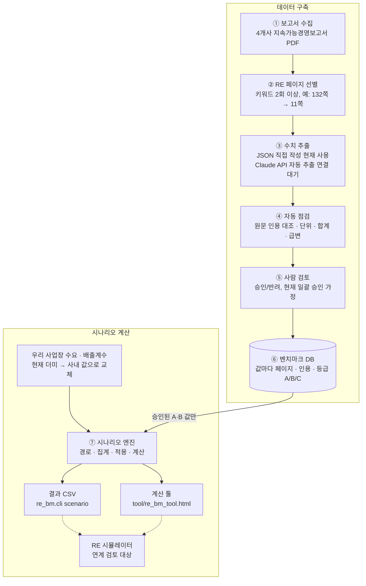

# 경쟁사 BM 시나리오 생성기 (REBM) 설명서

2026-11-24 기준

## 1. 개요

REBM은 경쟁사 지속가능경영보고서에서 재생에너지(RE) 확보 정보를 추출해 근거와 함께 DB로 저장하고, 이를 우리 회사 RE 전략의 '경쟁사 BM 시나리오'로 만드는 도구입니다. 산출물은 연도·국가(사업장)별 목표 RE 비율과 필요 RE 물량, 시장기반 Scope 2 배출량입니다.

- 대상 경쟁사: TSMC, SK hynix, Intel, Micron (`config/competitors.yaml`에 추가하면 확장 가능)
- 자료원: 공개된 지속가능경영보고서만 사용 (CDP 응답서는 비공개가 많아 제외)
- 위치: GitHub `g9lee-dot/carbonax`, 브랜치 `claude/renewable-energy-data-extraction-w445pd`, 폴더 `re_benchmark/`
- 구현: Python 3, SQLite, pdfplumber, Anthropic SDK(추출 단계만), 단일 HTML 계산 툴

| 구성요소 | 상태 | 비고 |
| --- | --- | --- |
| 보고서 수집 (4개사) | 완료 | TSMC는 Climate and Nature Report로 대체 |
| 페이지 선별 · 자동 점검 | 완료 | |
| 수치 추출 | JSON 수작업 완료, API 자동추출 대기 | API 키 연결 시 같은 경로로 동작 |
| 사람 검토 | 일괄 승인(가정) | 실제 검토 전 |
| 시나리오 계산 (CLI · 툴) | 완료 | 우리 사업장 수요·배출계수는 더미 |

## 2. 신뢰성 원칙

경쟁사 수치를 추정해서 만들지 않고, 공시된 값만 추적 가능하게 씁니다. 시나리오 결과의 모든 숫자는 보고서 페이지와 원문 인용까지 거슬러 올라갈 수 있습니다.

| 원칙 | 구현 |
| --- | --- |
| 모든 값에 근거를 남긴다 | 값마다 보고서(sha256), 페이지, 원문 인용 저장 |
| 추출값의 환각을 자동으로 거른다 | 인용문이 해당 페이지 텍스트에 실제로 있는지 대조(quote_verified) |
| 가공 수준을 등급으로 구분한다 | A 공시값 그대로 / B 공시값끼리 계산(산식 필수) / C 추정(시나리오 미사용) |
| 사람이 승인한 값만 쓴다 | pending → approved(검토자 필수) 상태만 시나리오 반영 |
| 단위는 추측해서 환산하지 않는다 | 모르는 단위는 표준값을 비워 검토 대상으로 넘김 (예: MTCO2e는 회사마다 뜻이 달라 자동 환산 안 함) |
| 국가별 값은 공시된 경우만 쓴다 | 경쟁사가 그 국가를 직접 공시하지 않았으면 전사 값으로 대체하고, 결과에 '전사 대체'로 표시 |

연도별 경로를 목표까지 직선으로 잇는 것(보간)은 우리 쪽 가정이므로, 보고 시 함께 밝힙니다.

## 3. 전체 워크플로우



왼쪽(위) 묶음은 보고서에서 데이터를 쌓는 단계, 오른쪽(아래) 묶음은 그 데이터로 시나리오를 계산하는 단계입니다. 점선은 아직 구현되지 않은 연계입니다. 같은 그림의 HTML 버전은 `docs/workflow.html`입니다.

## 4. 데이터 모델

SQLite 파일 하나(`data/re_benchmark.db`)에 5개 테이블이 있습니다. 스키마 정의는 `db/schema.sql`입니다.

| 테이블 | 내용 | 주요 컬럼 |
| --- | --- | --- |
| companies | 경쟁사 목록 | company_id, name, hq_country |
| reports | 적재한 보고서 | company_id, publication_year, file_path, sha256, assurance, boundary_note |
| re_metrics | 실적 지표 | data_year, geography, geography_level, metric, instrument, value_reported, unit_reported, value_std, data_quality, page, quote, quote_verified, review_status |
| re_targets | RE 목표 | geography, target_year, target_re_ratio, base_year, initiative, scope_note, page, quote |
| re_contracts | 개별 PPA 등 계약 | country, instrument, technology, capacity_mw, annual_mwh, start_year, counterparty |

**지표(metric) 종류:** total_electricity(총 전력), re_electricity(RE 전력, 수단별 또는 합계), re_ratio(RE 비율 %), scope2_market_based, scope2_location_based.

**지역(geography):** GLOBAL(전사), ISO 국가코드(KR, CN, US, TW 등), 권역(예: TSMC OVERSEAS), 사업장명.

**조달수단(instrument) 분류.** GHG Protocol Scope 2 Guidance와 RE100 기준에 맞춘 표준 분류입니다. RE 시뮬레이터와 맞춰야 할 핵심 항목입니다.

| 코드 | 의미 |
| --- | --- |
| onsite | 사업장 내 자가발전 |
| ppa_physical | 물리적(직접) PPA |
| ppa_virtual | 가상(금융) PPA |
| green_tariff | 유틸리티 녹색요금 (한국 녹색프리미엄 포함) |
| unbundled_eac | 별도 구매 인증서 (REC, I-REC, GO) |
| other / unspecified / total | 기타 / 수단 미기재 / RE 총량 |

**단위 표준:** 전력 MWh, 비율 %, 배출량 tCO2e. 보고서 원래 값과 단위(value_reported, unit_reported)도 함께 보관합니다.

## 5. 현재 적재 데이터

4개사 5개 보고서에서 지표 66건, 목표 7건, 계약 6건을 적재했고, 인용문은 전 항목이 원문 페이지에서 확인됐습니다. 2025년 전사 RE 비율은 Intel 99%, SK hynix 31.0%, TSMC 20.1%, Micron 13%입니다.

**전사 RE 전력 비율 실적 (%)**

| 회사 | 2021 | 2022 | 2023 | 2024 | 2025 |
| --- | --- | --- | --- | --- | --- |
| Intel | 80 | 93 | 99 | 98 | 99 |
| SK hynix | – | 29.6 | 30.0 | 29.9 | 31.0 |
| TSMC | – | – | – | – | 20.1 |
| Micron | – | 2 | 4 | 9 | 13 |

출처: 각사 2025~2026 지속가능경영보고서(re_metrics). Micron은 회계연도 기준.

**RE 목표**

| 회사 | 범위 | 목표연도 | 목표 RE 비율 | 근거 |
| --- | --- | --- | --- | --- |
| Intel | 전사 | 2030 | 100% | CSR 2025-26 p.36 |
| TSMC | 전사 | 2030 | 60% | Climate and Nature Report p.39 (연도는 p.5 로드맵 기준, 본 보고서로 확인 필요) |
| TSMC | 전사 | 2040 | 100% | p.15 |
| SK hynix | 전사 | 2026 | 31% | 2026 보고서 p.25 |
| SK hynix | 전사 | 2030 | 33% | p.23 |
| SK hynix | 전사 | 2050 | 100% | p.23 (RE100) |
| Micron | 미국 | 2025 | 100% | 2026 보고서 p.35 (달성). 전사 수치 목표 없음 |

**국가별 공시 RE 비율 (2025)**

| 국가·지역 | 공시 회사와 값 |
| --- | --- |
| 중국 | Intel 100%, Micron 100%, SK hynix 100% |
| 미국 | Intel 100%, Micron 100% |
| 대만 | TSMC 11.5% |
| 말레이시아 | Intel 100%, Micron 100% |
| 아일랜드·이스라엘·폴란드·베트남 | Intel 100% |
| 코스타리카 / 인도 | Intel 97% / 0% |
| TSMC 해외 자회사(국가 미기재) | TSMC 100% |
| 한국 | 공시 없음 (SK hynix 31%는 한국+중국 전사 값) |

**보고 경계 주의사항**

- Micron: 회계연도 기준(FY25 = 2024.9~2025.8). 13%에는 고객사에 우선 배분한 683,641 MWh 포함, 미배분 RE는 5.9%.
- SK hynix: 데이터 범위 이천·청주·분당·서울·우시·충칭. Scope 2 표는 location-based, market-based는 Scope 1+2 합계만 공시.
- TSMC: 본 Sustainability Report 미확보. 총 전력사용량·Scope 2 미추출.
- Intel: 역년 기준. 조달수단별 물량은 4개사 모두 미공시.

## 6. 시나리오 계산 로직

경쟁사별 RE 비율 경로를 만들고, 이를 집계한 벤치마크 비율을 우리 사업장 수요에 곱합니다. 구현은 `re_bm/scenario.py`(CLI)와 `tool/re_bm_tool.html`(툴)이며, 두 결과는 더미 수요 75건에서 1 MWh 이내로 일치합니다.

1. **경로 생성 (회사·지역별):** 실적 연도는 실적값. 마지막 실적 이후는 공시 목표연도까지 선형 보간하고, 마지막 목표 이후에는 그 값을 유지. 목표가 없는 회사는 최근 실적을 유지.
2. **집계 (method):** 평균(average), 중앙값(median), 최고치(leader), 특정 회사(company_id). 포함 회사를 고를 수 있음.
3. **적용 (mode):** global = 전사 경로를 모든 사업장에 적용. country = 사업장 국가를 공시한 회사가 있으면 국가 경로, 없으면 전사 경로로 대체.
4. **계산:** 아래 식을 연도·사업장마다 적용. 조달수단별 배분은 경쟁사 수단별 물량 공시가 없어 현재는 unspecified 처리.

```
RE[y,s]     = D[y,s] × BM[y, g(s)] / 100
S2_MB[y,s]  = (D[y,s] − RE[y,s]) × EF[s]
```

D = 사업장 전력수요(MWh), BM = 벤치마크 RE 비율(%), g(s) = 적용 지역(국가 또는 GLOBAL), EF = 배출계수(tCO2/MWh).

**입력: 사업장 수요 CSV** (`data/our_demand_template.csv` 형식, 현재 값은 더미)

```csv
year,site,country,demand_mwh,grid_ef_tco2_per_mwh
2030,KR_Fab,KR,22510176,0.4567
2030,US_Austin,US,2601510,0.37
```

**출력: 결과 CSV** (`re_bm.cli scenario`, 툴의 'CSV 복사'도 동일 항목)

| 컬럼 | 의미 |
| --- | --- |
| year, site, country, demand_mwh | 입력 그대로 |
| bm_re_ratio_pct | 적용된 벤치마크 RE 비율 |
| re_mwh, re_mwh_<수단> | 필요 RE 물량과 수단별 배분 |
| scope2_mb_tco2e | 시장기반 Scope 2 |
| basis | global / country_reported / fallback_global |
| bm_method, bm_companies | 집계 방법과 반영된 회사 |

**더미 기준 결과 (2030년, 평균):** 전사 기준 벤치마크 51.5%, 필요 RE 약 16.0 TWh. 국가별 기준 수요 가중 64.9%, 약 20.2 TWh(중국·미국 100%, 한국은 전사 51.5%로 대체).

### 6-1. 경쟁사 RE 수준 비교 (수요 없이 시나리오만)

6장과 달리 우리 회사 수요·배출계수 없이, "누구 수준을 따라가면" 시나리오들을 나란히 만듭니다. RE 시뮬레이터에 목표 경로로 넘기는 용도입니다.

- **받는 것:** 승인된 경쟁사 전사 RE 비율 실적·목표(DB), 연도 범위, 업계 수준 계산에 포함할 회사
- **처리:** 회사별 경로는 6장 1과 같은 규칙. 업계 최고·평균·최저는 연도마다 포함 회사 경로 중 최고값·평균·최저값이며, 그 해 최고·최저를 정한 회사도 기록합니다.
- **내보내는 것:**
  - CSV(`data/output/bm_levels.csv`): `year, industry_max, industry_max_by, industry_avg, industry_min, industry_min_by, n_companies, intel, micron, skhynix, tsmc`
  - JSON 시나리오 패키지(`data/output/bm_levels.json`): 시나리오별 경로(`scenarios[].path`), 근거, 지역 각주(`regional_notes`)
- **실행:** `python -m re_bm.cli bm-levels --from-year 2025 --to-year 2040`, 화면 툴은 `tool/bm_levels_tool.html`
- **지역:** 국가별 공시값은 시나리오에 반영하지 않고 각주로만 제공합니다(5장 국가별 표와 같은 내용).

**업계 수준 산정 규칙:** 업계 최고·평균·최저는 연도가 붙은 전사 RE 비율 목표를 공시한 회사로만 계산합니다(현재 TSMC, SK hynix, Intel). 목표가 없는 회사는 경로가 최근 실적에 고정되어, 넣으면 업계 최저·평균이 '개선 없음' 가정에 끌려가기 때문입니다. 이런 회사는 자기 시나리오로만 표시하고, 목표를 공시하면 자동으로 다시 포함됩니다. 필요하면 `--include-no-target`(화면 툴은 "전사 RE 목표 미공시 회사도 포함" 스위치)으로 포함할 수 있습니다.

Micron은 미국 100%(2025년 말, 달성), 말레이시아·중국 100% 유지, 연도 없는 '가능한 곳에서 전 세계 무탄소전력 100%' 지향, Scope 1+2 넷제로 2050년(지향)을 공시했지만, 연도가 붙은 전사 RE 비율 목표는 없어 업계 수준에서 제외됩니다(2026 보고서 p.34~35).

| 시나리오 | 2025 | 2030 | 2035 | 2040 |
| --- | --- | --- | --- | --- |
| 업계 최고 | 99.0 (Intel) | 100 (Intel) | 100 (Intel) | 100 (Intel·TSMC) |
| 업계 평균 | 50.0 | 64.3 | 76.6 | 88.8 |
| 업계 최저 | 20.1 (TSMC) | 33.0 (SK hynix) | 49.8 (SK hynix) | 66.5 (SK hynix) |
| TSMC | 20.1 | 60.0 | 80.0 | 100 |
| SK hynix | 31.0 | 33.0 | 49.8 | 66.5 |
| Intel | 99.0 | 100 | 100 | 100 |
| Micron (업계 수준 제외) | 13.0 | 13.0 | 13.0 | 13.0 |

단위: 전사 RE 전력 비율(%). 업계 수준은 TSMC·SK hynix·Intel 기준. Micron을 포함하면 2030년 업계 평균 51.5%, 최저 13.0%(Micron)입니다.

**업계 최고·평균·최저 계산 방법.** 연도마다 업계 수준 대상 회사(현재 TSMC, SK hynix, Intel)의 경로 값을 놓고 최고값, 단순 산술평균, 최저값을 구합니다. 평균은 회사 규모(전력사용량)로 가중하지 않으며, 세 회사가 같은 비중입니다.

| 연도 | TSMC | SK hynix | Intel | 업계 평균 |
| --- | --- | --- | --- | --- |
| 2025 | 20.1 (실적) | 31.0 (실적) | 99.0 (실적) | (20.1 + 31.0 + 99.0) / 3 = 50.0 |
| 2027 | 36.1 (20.1 → 2030년 60 보간) | 31.5 (2026년 31 → 2030년 33 보간) | 99.4 (99 → 2030년 100 보간) | 55.7 |
| 2030 | 60.0 (목표) | 33.0 (목표) | 100 (목표) | (60 + 33 + 100) / 3 = 64.3 |

전력사용량 가중평균으로 바꾸면 Intel(약 10 TWh) 대비 SK hynix(13.7 TWh) 등 규모가 큰 회사 비중이 커지지만, TSMC 총 전력사용량이 아직 추출되지 않아 지금은 계산할 수 없습니다.

## 7. RE 시뮬레이터 연계 검토 포인트

REBM은 "어느 수준까지 가야 하는가(경쟁사 근거)"를, RE 시뮬레이터는 "어떻게, 얼마에 갈 수 있는가"를 담당하도록 나누는 것을 제안합니다. 아래는 RE 시뮬레이터 코드를 보지 않고 작성한 가정 기반 안입니다.

**연계 시나리오 후보**

| 연계 | 흐름 | 얻는 것 |
| --- | --- | --- |
| 목표 주입 (우선 권장) | REBM 연도·국가별 목표 RE 비율 → 시뮬레이터 목표 제약 | 경쟁사 수준 추종 시 필요 물량·수단 구성·비용 |
| 갭 분석 | 시뮬레이터 국가별 확보 가능 최대치 ↔ REBM 경로 | 따라갈 수 없는 국가·연도와 부족분 |
| 가정 검증 | REBM 계약 사례(re_contracts) → 시뮬레이터 수단 가정 점검 | 규모·형태 참고값 (예: Micron 텍사스 VPPA 238MW, SK hynix 국내 수력 PPA) |
| 비교 시각화 | 시뮬레이터 결과를 REBM 경로 차트에 중첩 | 우리 계획 vs 경쟁사 경로 |

**인터페이스 계약안 (파일 교환, JSON).** REBM이 내보내고 시뮬레이터가 읽는 형태입니다. 6-1의 `bm-levels`가 시나리오별 경로·근거·지역 각주를 담은 패키지를 이미 만들며, 시뮬레이터 입력 형식이 확정되면 맞춰 조정합니다.

```json
{
  "scenario_id": "competitor_bm_average_country",
  "source": "REBM",
  "method": "average", "mode": "country",
  "companies": ["tsmc", "skhynix", "intel", "micron"],
  "generated_at": "2026-11-23", "data_status": "approved (assumed)",
  "targets": [
    {"year": 2030, "country": "KR", "re_ratio_pct": 51.5, "basis": "fallback_global", "evidence_ids": [12, 31]},
    {"year": 2030, "country": "US", "re_ratio_pct": 100, "basis": "country_reported"}
  ],
  "reference_contracts": [
    {"company": "micron", "country": "US", "instrument": "ppa_virtual", "capacity_mw": 238}
  ]
}
```

**사내망에서 확인할 것**

- [ ] 시뮬레이터가 목표를 비율(%)로 받는지, 물량(MWh)으로 받는지
- [ ] 목표 단위가 국가별인지 사업장별인지, 연도 범위(현재 2026~2040)
- [ ] 조달수단 분류가 4장의 7개 코드와 1:1로 대응되는지 (녹색프리미엄·REC 구분 포함)
- [ ] 전력수요·배출계수의 기준 출처를 시뮬레이터와 공유할지 (REBM의 더미를 사내 값으로 대체)
- [ ] 시뮬레이터가 비용·확보 한도 결과를 내는지 (갭 분석 가능 여부)
- [ ] 연계 방식: 파일 교환 / 공유 DB / API 중 사내 환경에서 가능한 것
- [ ] 사내망 반입 제약: Anthropic API 사용 가능 여부 (불가 시 JSON 수작업 경로로 운영)

## 8. 한계와 후속 과제, 파일 위치

**현재 한계**

- 한국 사업장에 적용할 경쟁사 국가별 공시값이 없어 전사 값으로 대체됩니다.
- 조달수단별 물량을 공시한 경쟁사가 없어 수단 구성은 벤치마크하지 못합니다(정성 정보만 보관).
- 추출값은 사람 검토 없이 일괄 승인된 상태입니다.
- TSMC는 본 보고서가 없어 목표연도(2030년 60%) 확인이 필요합니다.
- 경로의 직선 보간은 가정입니다. 회계연도(Micron)와 역년 차이도 보정하지 않았습니다.
- 조달수단별 비용은 계산하지 않습니다(RE 시뮬레이터 연계 대상).

**후속 과제**

- [ ] 추출값 실제 검토 (`review export` → 승인/반려 → `review import`)
- [ ] 사내 전력수요 전망·배출계수로 더미 대체
- [ ] RE 시뮬레이터 입력 형식 확인 후 `bm-levels` 시나리오 패키지 형식 조정
- [ ] 사내 RAG·LLM으로 추출 연동 (10장), 경쟁사 추가 시 매년 갱신

**파일·명령어 (`re_benchmark/` 기준)**

| 구분 | 위치 / 명령 |
| --- | --- |
| 경쟁사 목록 | `config/competitors.yaml` |
| 보고서·출처 | `data/reports/<회사>/`, `data/reports/SOURCES.md` |
| 추출 결과(JSON) | `data/extractions/*.json` |
| DB·스키마 | `data/re_benchmark.db`, `db/schema.sql` |
| 추출·적재 | `python -m re_bm.cli extract <회사> <PDF> --year <발간연도> [--from-json <파일>]` |
| 검토 | `python -m re_bm.cli review export` / `import` (결과: `data/review/`) |
| 비율 산출(B등급) | `python -m re_bm.cli derive` |
| 시나리오 CSV | `python -m re_bm.cli scenario <수요CSV> --mode global\|country --method average\|median\|leader\|<회사>` |
| 계산 툴 | `python -m re_bm.tool` → `tool/re_bm_tool.html` |
| 수준 비교 | `python -m re_bm.cli bm-levels …` → `data/output/bm_levels.csv/json`, 화면 툴 `tool/bm_levels_tool.html` |
| 테스트 | `python -m pytest tests` |
| 워크플로우 그림 | `docs/workflow.html` |

## 9. 내려받기

레포는 공개(public) 상태이며, 작업물은 기본 브랜치가 아닌 아래 브랜치에 있습니다.

- 브랜치 페이지: https://github.com/g9lee-dot/carbonax/tree/claude/renewable-energy-data-extraction-w445pd/re_benchmark
- 전체 ZIP: https://github.com/g9lee-dot/carbonax/archive/refs/heads/claude/renewable-energy-data-extraction-w445pd.zip
- git: `git clone -b claude/renewable-energy-data-extraction-w445pd https://github.com/g9lee-dot/carbonax.git`
- 이 문서 원문(raw): https://raw.githubusercontent.com/g9lee-dot/carbonax/claude/renewable-energy-data-extraction-w445pd/re_benchmark/docs/REBM_guide.md

연계 검토에 필요한 최소 파일은 `re_bm/scenario.py`, `db/schema.sql`, `data/re_benchmark.db`, `data/our_demand_template.csv`, 이 문서입니다. 보고서 PDF(약 55MB)는 근거 확인이 필요할 때만 받으면 됩니다.

## 10. 사내 RAG·LLM으로 추출하기

LLM은 전체 흐름 중 **③ 수치 추출에만** 필요합니다. 나머지(페이지 선별, 점검, 검토, DB, 시나리오·수준 비교)는 LLM 없이 규칙대로 계산하는 코드이며, 같은 입력이면 항상 같은 결과가 나옵니다. 사내 RAG에 ESG 보고서 전문을 인덱싱해 두면 역할은 다음처럼 나뉩니다.

| 역할 | 담당 | 대체하는 기존 단계 |
| --- | --- | --- |
| 관련 문단 찾기 | 사내 RAG 검색 | ② RE 페이지 선별(키워드) |
| 문단을 정해진 JSON으로 옮겨 적기 | 사내 LLM | ③ 수치 추출(Claude API) |
| 원문 대조·점검·검토·저장·계산 | REBM 코드 | ④~⑦ 그대로 |

**RAG의 질의응답 결과를 그대로 쓰지 않습니다.** 요약된 답에는 페이지·원문 인용이 빠지거나 흐려지고, 연도나 기준(전력 기준 vs 총에너지 기준)이 섞일 수 있습니다(예: Micron은 같은 보고서에 총에너지 기준 10%, 전력 기준 13%). 검색(문단 + 페이지)과 추출(JSON)을 두 단계로 나눕니다.

### 10-1. 인덱싱할 때

- 문단(청크)마다 **문서명, 회사, 발간연도, 페이지 번호**를 메타데이터로 저장합니다. 페이지가 없으면 근거 추적이 안 됩니다.
- 수치 대부분은 부록 데이터 표에 있습니다. **표는 쪼개지 않고 한 청크로** 두거나, 검색된 청크의 **페이지 전체 텍스트**를 다시 가져올 수 있게 합니다.
- 청크 텍스트는 보고서 원문 그대로 저장합니다(요약 금지). 원문 대조의 기준이 됩니다.

### 10-2. 검색 질의 (회사별로 모두 실행, 결과 합쳐 중복 제거)

| 목적 | 질의 예 (국문 · 영문 모두) |
| --- | --- |
| RE 비율 | 재생에너지 사용률, 재생에너지 비율 / renewable electricity percentage, share of renewable electricity |
| 전력 사용량 | 전력 사용량, 총 전력 / electricity consumption, purchased electricity, energy consumption MWh GWh |
| 조달 수단 | PPA, 전력구매계약, REC, 녹색프리미엄, 자가발전 / power purchase agreement, VPPA, renewable energy certificate, green tariff, on-site solar |
| 목표 | RE100, 재생에너지 목표 / renewable electricity goal target 2030 2040 2050 |
| 배출량 | Scope 2 시장기반 / Scope 2 market-based location-based |
| 국가별 | 국가별 재생에너지, 해외 사업장 / renewable electricity by country, site |

질의마다 상위 10~20개 청크를 가져와 페이지 기준으로 묶은 뒤 LLM에 넘깁니다. 한 번에 넘기는 양이 많으면 페이지 묶음 단위로 나눠 여러 번 호출합니다.

### 10-3. LLM 지시문 (시스템 프롬프트)

현재 REBM 코드(`re_bm/extract.py`)에 들어 있는 지시문입니다. 사내 LLM에도 그대로 씁니다.

```text
You extract renewable-electricity data from a company's sustainability report for a benchmark database.

Rules:
- Extract only values explicitly printed in the given pages. Never calculate, convert, infer or fill gaps. If a value is absent, omit it.
- Keep each value and unit exactly as printed. Record the [PAGE n] number where it appears and a short verbatim quote copied character-for-character from that page.
- Map procurement methods to the instrument taxonomy:
  onsite = self-generation on company premises; ppa_physical = physical/direct PPA; ppa_virtual = virtual/financial PPA;
  green_tariff = utility green tariff/green pricing programs (incl. Korea 녹색프리미엄); unbundled_eac = separately purchased certificates (REC, I-REC, GO) not bundled with power;
  other = anything else (e.g. third-party REC bundled with power, utility default renewable mix claimed); unspecified = method not stated; total = total renewable electricity.
- Use geography 'GLOBAL' with level 'global' for company-wide figures. Use country codes only when the report states the figure for that country.
- Electricity-only: exclude renewable heat/fuel figures. If a table mixes energy types, take only electricity rows.
- Include every reported year shown (e.g. 3-year data tables).
```

사용자 메시지에는 회사명과 검색된 청크를 페이지 표시와 함께 넣습니다.

```text
Company: SK hynix

Report pages:

[PAGE 103]
<그 페이지(또는 청크)의 원문 텍스트>

[PAGE 25]
<원문 텍스트>
```

### 10-4. 출력 JSON 형식

출력 형식 정의는 `docs/extraction_schema.json`(JSON Schema)입니다. 사내 LLM이 구조화 출력(JSON 스키마 지정)을 지원하면 이 파일을 그대로 지정하고, 지원하지 않으면 지시문 끝에 "이 스키마에 맞는 JSON만 출력"이라고 붙입니다. 실제 예시는 `data/extractions/*.json`에 있습니다.

```json
{
 "assurance": null,
 "boundary_note": "데이터 범위: 이천, 청주, 분당, 서울, 우시, 충칭",
 "metrics": [
  {"data_year": 2025, "geography": "GLOBAL", "geography_level": "global", "metric": "re_ratio",
   "instrument": null, "value": 31.0, "unit": "%", "page": 103, "quote": "사용률 % 29.6 30.0 29.9 31.0"}
 ],
 "targets": [
  {"geography": "GLOBAL", "target_year": 2030, "target_re_ratio": 33, "base_year": 2020, "initiative": "RE100",
   "scope_note": "2030 중간 목표", "page": 23, "quote": "재생에너지 사용률 33% 달성을 중간 목표로 수립했습니다."}
 ],
 "contracts": []
}
```

### 10-5. REBM에 넣기

회사·보고서별 JSON을 저장한 뒤 기존 명령으로 적재합니다. 적재 시 인용문이 원본 PDF 해당 페이지에 실제로 있는지 자동 대조하고(`quote_verified`), 모든 값은 검토 대기 상태로 들어갑니다.

```bash
python -m re_bm.cli extract skhynix data/reports/skhynix/SK_hynix_Sustainability_Report_2026.pdf --year 2026 --from-json skhynix_2026.json
python -m re_bm.cli review export      # 검토 → approved/rejected
python -m re_bm.cli review import
python -m re_bm.cli bm-levels          # 수준 비교 시나리오
```

- RAG 청크의 페이지 번호는 **PDF 페이지 순번(1부터)**이어야 원문 대조가 맞습니다. 보고서에 인쇄된 쪽번호와 다를 수 있으니 인덱싱 시 기준을 확인합니다.
- 원본 PDF를 사내 REBM 환경에 둘 수 없다면, 대조 기준을 RAG 청크 원문으로 바꾸는 작은 수정이 필요합니다(`re_bm/extract.py`의 `quote_on_page`).
- 결과 확인 방법: `review export`로 나온 CSV에서 `quote_verified=0`이거나 `flags`가 있는 행을 먼저 검토합니다.
